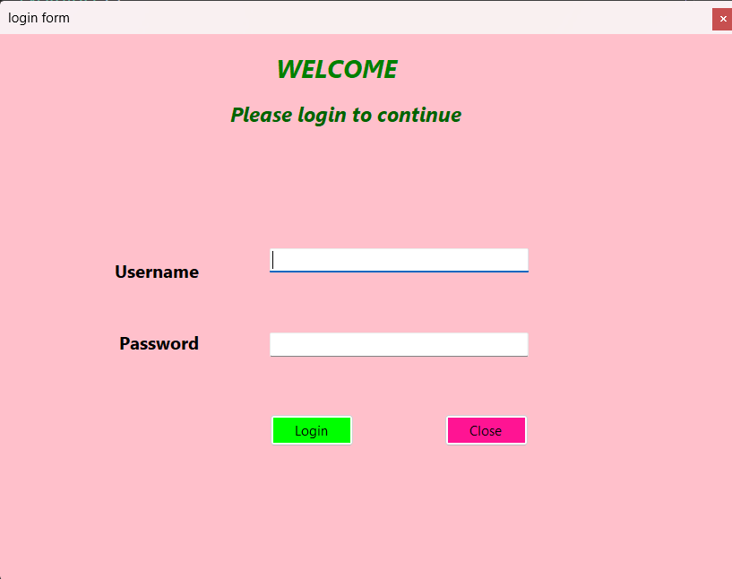
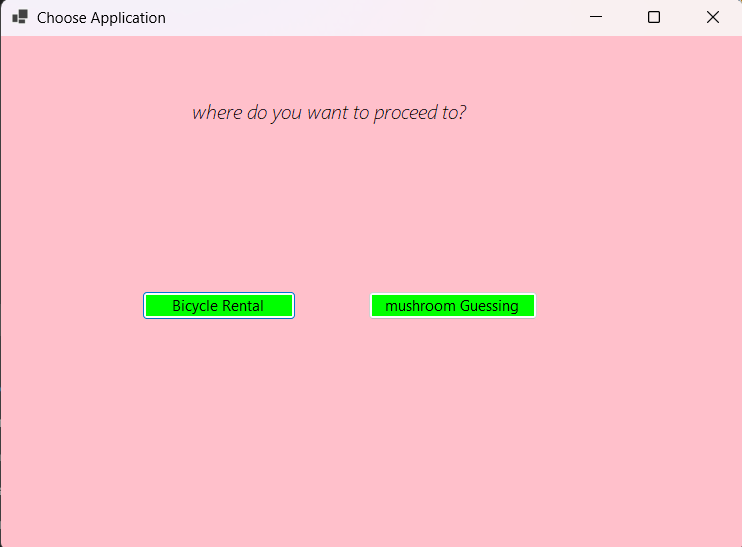
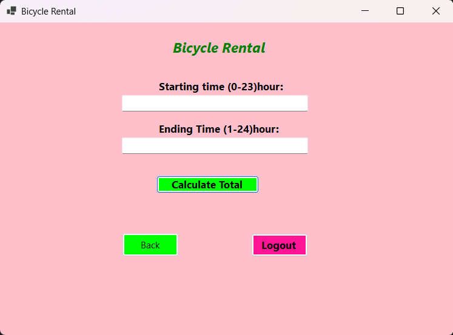
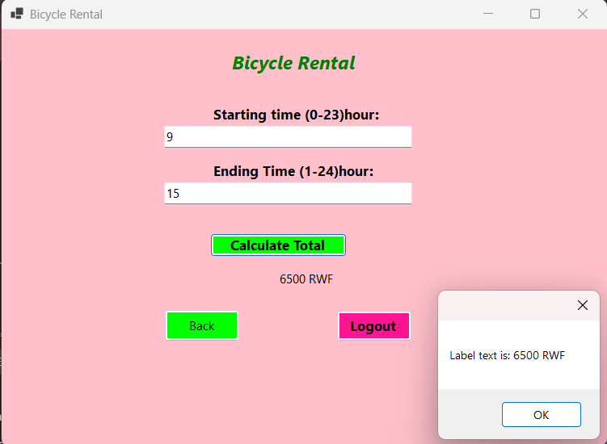
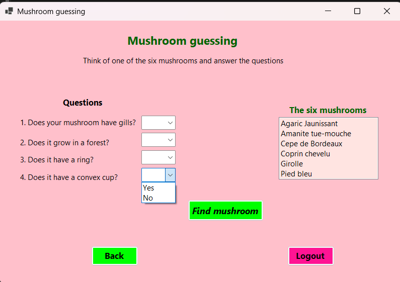
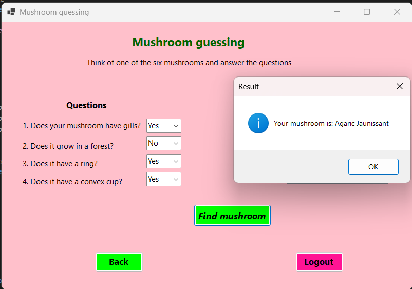

# Bicycle Rental and Mushroom Guessing

A C# Windows Forms desktop application (namespace `janviere`) built for **Lab 1**. It covers variables, operators, decision control statements and loops. After logging in, the user chooses between two mini programs: a bicycle rental calculator and a mushroom guessing game.

## Author

- **Name:** [your name]
- **Student number:** [your student number]
- **Course:** Information Technology, Adventist University of Central Africa (AUCA)

## Features

- Login form with a Close button
- Choose menu to open Bicycle Rental or Mushroom Guessing
- Bicycle Rental calculator with input validation
- Mushroom Guessing game based on a decision tree
- Back and Logout buttons on both programs

## Application flow

```
Login -> Choose -> Bicycle Rental  (Back -> Choose, Logout -> Login)
                -> Mushroom Guessing (Back -> Choose, Logout -> Login)
```

| Form | Class | Purpose |
|---|---|---|
| Login form | `Form1` | Asks for username and password |
| Choose Application | `Form2` | Opens Bicycle Rental or Mushroom Guessing |
| Bicycle Rental | `Form3` | Calculates the rental cost |
| Mushroom guessing | `Form4` | Finds the mushroom from the answers |

Each form opened from Choose receives the Choose form as `previousForm`. **Back** shows it again, and **Logout** closes every open form and shows the login form.

## Screenshots

### Login form


### Choose Application


### Bicycle Rental


Example result (start 9, end 15):



### Mushroom Guessing


Example result:



## Problem 1: Bicycle Rental

The user enters a starting hour and an ending hour, then clicks **Calculate Total**. The total appears under the button.

### Input rules

- Both values must be whole numbers (no decimals).
- Starting time is between 0 and 23.
- Ending time is between 1 and 24.
- Starting time must be less than ending time (no rental spans more than one day).
- An invalid input shows a message and the cursor returns to the faulty box.

### Hourly rates

| Hours | Rate per hour |
|---|---|
| 0 - 7 and 21 - 24 | 500 RWF |
| 7 - 14 and 19 - 21 | 1000 RWF |
| 14 - 19 | 1500 RWF |

A `for` loop goes through each rented hour, picks the rate for that hour and adds it to the total.

**Example:** start 9, end 15 gives hours 9 to 13 at 1000 RWF (5 hours) plus hour 14 at 1500 RWF, so the total is **6500 RWF**.

## Problem 2: Mushroom Guessing

The user thinks of one of six mushrooms:

- Agaric Jaunissant
- Amanite tue-mouche
- Cepe de Bordeaux
- Coprin chevelu
- Girolle
- Pied bleu

### Facts used

- Cepe de Bordeaux is the only one with pores. The others have gills.
- Coprin chevelu and Agaric Jaunissant grow in meadows. The others grow in forests.
- Only Agaric Jaunissant, Amanite tue-mouche and Pied bleu have a convex cup.
- Only Agaric Jaunissant, Amanite tue-mouche and Coprin chevelu have a ring.

### Questions (Yes / No dropdowns)

1. Does your mushroom have gills?
2. Does it grow in a forest?
3. Does it have a ring?
4. Does it have a convex cup?

### Decision tree

The decision tree never needs more than three of the four answers.

```
Ring?
├─ Yes -> Forest?
│         ├─ Yes -> Amanite tue-mouche
│         └─ No  -> Convex cup?
│                   ├─ Yes -> Agaric Jaunissant
│                   └─ No  -> Coprin chevelu
└─ No  -> Gills?
          ├─ No  -> Cepe de Bordeaux
          └─ Yes -> Convex cup?
                    ├─ Yes -> Pied bleu
                    └─ No  -> Girolle
```

### Test cases

| Gills | Forest | Ring | Convex cup | Result |
|---|---|---|---|---|
| any | Yes | Yes | any | Amanite tue-mouche |
| any | No | Yes | Yes | Agaric Jaunissant |
| any | No | Yes | No | Coprin chevelu |
| No | any | No | any | Cepe de Bordeaux |
| Yes | any | No | Yes | Pied bleu |
| Yes | any | No | No | Girolle |

## How to run

1. Open the solution in Visual Studio.
2. Check that `Program.cs` contains `Application.Run(new Form1());`.
3. Click **Build > Rebuild Solution**.
4. Press `F5`.
5. Log in, then choose Bicycle Rental or Mushroom Guessing.

## Requirements

- Windows
- Visual Studio with the **.NET desktop development** workload
- .NET Framework / .NET with Windows Forms support

Thank you so much for visiting my Repository.
---
